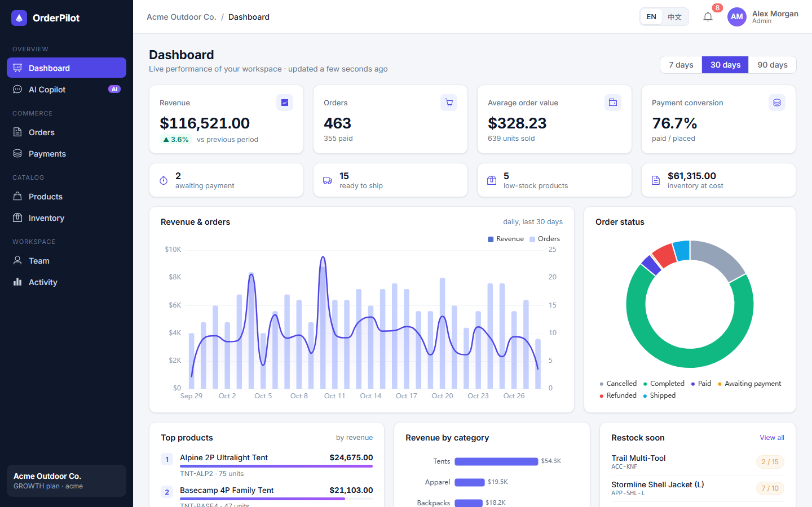
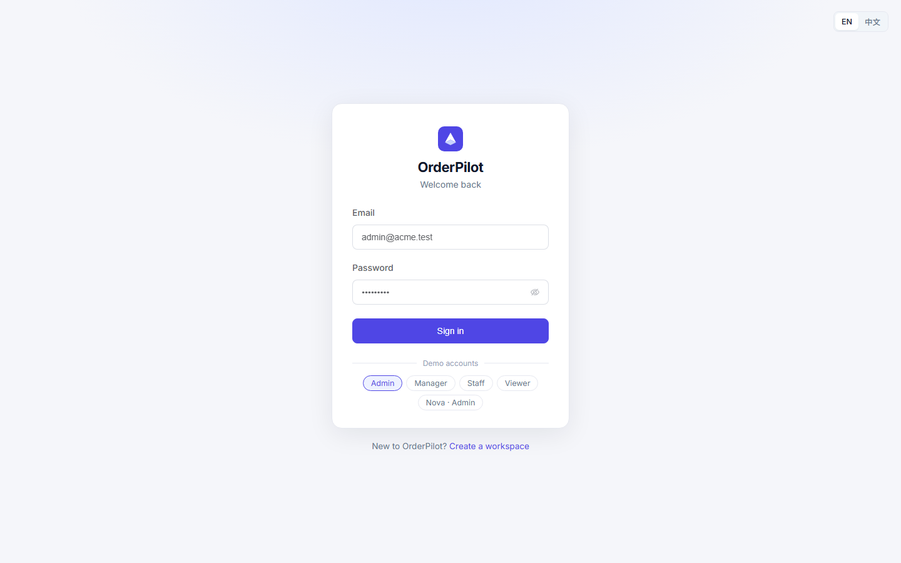
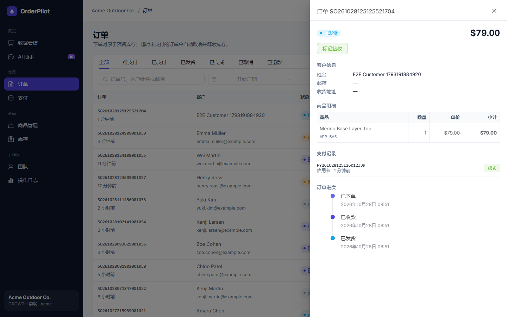
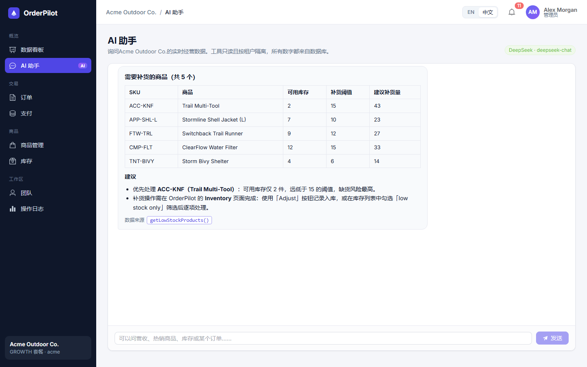

[简体中文](README.md) | **English**

# OrderPilot

OrderPilot is a multi-tenant order and inventory SaaS: a modular-monolith Spring Boot backend, a Vue 3 dashboard and an AI business copilot.

The product is small, but the hard engineering problems are handled to production standards: no overselling under concurrency, no duplicate orders from repeated submits, reliable messaging between MySQL and RabbitMQ, unpaid orders cancelled on time, Redis caching, and tenant isolation enforced at three layers. The copilot reads real data only through read-only, tenant-scoped tools, so it cannot invent numbers.



## Status

V1 is functionally complete and runs end to end: backend, bilingual frontend, AI copilot, demo data, automated tests, Docker Compose deployment and GitHub Actions CI. [CI passes on GitHub](https://github.com/JaxLim/OrderPilot/actions).

Not implemented yet, or deliberately simplified:

- The payment gateway is simulated. If the process crashes exactly between the two payment transactions, there is no reconciliation job yet for the leftover `PENDING` payment.
- Notifications poll every 10 seconds (no SSE yet). Copilot answers are not streamed, and conversations are not saved.
- Demo history orders are inserted directly, without outbox events or per-order stock ledger rows.
- Business data (product and customer names, audit details) is not translated; only the interface is.

The full list is in [PROJECT_STATUS.md](PROJECT_STATUS.md).

## Screenshots

| Sign in | Order detail (Chinese UI) | AI copilot (DeepSeek, Chinese UI) |
| --- | --- | --- |
|  |  |  |

## Hard problems and how they are solved

| Problem | Approach | Proof |
| --- | --- | --- |
| Overselling under concurrency | A single conditional `UPDATE … WHERE available >= qty` checks and decrements atomically; order lines are locked in product-id order to avoid deadlocks | `InventoryConcurrencyIT`: 40 concurrent buyers, 10 units, exactly 10 orders |
| Duplicate submits and retries | `Idempotency-Key` header → Redis `SET NX` claim with a replayable response; `UNIQUE(tenant_id, idempotency_key)` as the last line of defence | `IdempotencyIT`: 15 concurrent duplicates, 1 order |
| MySQL ↔ RabbitMQ dual write | Transactional outbox (`Propagation.MANDATORY`); the relay uses publisher confirms, mandatory returns, retries with back-off and `FOR UPDATE SKIP LOCKED` | `OrderLifecycleIT` |
| At-least-once delivery | Idempotent consumers (a de-dup row in the same transaction); listener retries, then a dead-letter queue | same test, asserting no duplicate notifications |
| Unpaid orders holding stock | A RabbitMQ TTL + dead-letter delay queue cancels exactly at expiry; a scheduled sweeper is the safety net; both use a CAS on status | `OrderLifecycleIT` |
| Payment vs. timeout race | Three-step payment: TX1 locks and writes PENDING → gateway call outside any transaction → TX2 CAS; money captured for an expired order is refunded automatically | `PaymentService` |
| Tenant data leaks | The tenant comes only from the signed JWT; every SQL statement filters by `tenant_id`; a MyBatis interceptor **rejects** any statement on a tenant table without `tenant_id` | `SecurityAndTenancyIT`, `UnitTests` |
| Hot catalog reads | Redis cache-aside with TTL jitter, a null sentinel against penetration, delete-after-commit invalidation and graceful degradation; stock is never cached | `ProductCache` |
| An AI that invents numbers | Spring AI `ChatClient` with 7 read-only `@Tool`s bound to the tenant on the server; a deterministic offline analyst when no key is configured | `OrderLifecycleIT`, Playwright |

## Tech stack

- **Backend**: Java 21, Spring Boot 3.5, Spring Security (JWT, method security), MyBatis, MySQL 8.4 + Flyway, Redis 7, RabbitMQ 3, Spring AI 1.1 (DeepSeek through the OpenAI-compatible API), springdoc OpenAPI
- **Frontend**: Vue 3 + TypeScript, Vite, Element Plus, Pinia, Vue Router, vue-i18n (English / 简体中文), ECharts
- **Testing**: JUnit 5 + Testcontainers (real MySQL / Redis / RabbitMQ), Playwright end-to-end tests
- **Delivery**: Docker multi-stage builds, Docker Compose, nginx, GitHub Actions

### Architecture

The backend is one deployable modular monolith, split by business capability:

```
backend/src/main/java/com/orderpilot/
  common/        API envelope, errors, TenantContext + tenant interceptor, idempotency
  iam/           JWT auth, roles and permissions, users, tenants
  catalog/       products + Redis cache-aside
  inventory/     atomic stock reservation, movement ledger
  order/         order state machine, timeout handling (message queue + sweeper)
  payment/       simulated gateway, three-step payment, refunds
  messaging/     transactional outbox, relay, RabbitMQ topology, consumer de-dup
  notification/  event consumer → in-app notifications
  analytics/     dashboard read models (Redis-cached)
  ai/            Spring AI copilot, tools, offline analyst
  audit/         activity trail
  demo/          demo data seeder
frontend/        Vue 3 dashboard + Playwright tests
docs/            ARCHITECTURE.md, INTERVIEW_GUIDE.md, screenshots
```

Modules call each other through service methods; side effects are published as domain events through the outbox to RabbitMQ. See [docs/ARCHITECTURE.md](docs/ARCHITECTURE.md) for the full design.

## Quick start (Docker)

All you need is [Docker Desktop](https://www.docker.com/products/docker-desktop/) (or Docker Engine with the Compose plugin).

```bash
git clone https://github.com/JaxLim/OrderPilot.git
cd OrderPilot
docker compose up -d --build --wait
```

The first build downloads all Maven dependencies inside the build container and can take over ten minutes. Once every container is healthy, open **http://localhost:8081** and sign in with a demo account. The password is `Passw0rd!` for all of them:

| Email | Role | Workspace |
| --- | --- | --- |
| `admin@acme.test` | Admin | Acme Outdoor Co. (about 75 days of orders) |
| `manager@acme.test` | Manager | Acme Outdoor Co. |
| `staff@acme.test` | Staff | Acme Outdoor Co. |
| `viewer@acme.test` | Viewer (read-only) | Acme Outdoor Co. |
| `admin@nova.test` | Admin | Nova Electronics (a separate tenant) |

Switch the language with the **EN / 中文** toggle on the sign-in page or in the top bar; the choice is remembered in the browser.

Other endpoints:

- API: http://localhost:8080/api
- Swagger UI: http://localhost:8080/swagger-ui.html
- RabbitMQ console: http://localhost:15672 (guest / guest)

Stop with `docker compose down`, or `docker compose down -v` to delete the data as well.

## Configure the AI copilot (optional)

Without a key, the copilot runs in **offline analyst** mode: the same tools and the same real data, with deterministic answers in English or Chinese. To use DeepSeek (or any OpenAI-compatible API):

```bash
cp .env.example .env
# edit .env and set AI_API_KEY
docker compose up -d --build
```

| Variable | Default | Purpose |
| --- | --- | --- |
| `AI_API_KEY` | empty | API key; empty means offline analyst mode |
| `AI_BASE_URL` | `https://api.deepseek.com` | Any OpenAI-compatible endpoint |
| `AI_MODEL` | `deepseek-chat` | Model name |
| `AI_PROVIDER_NAME` | `DeepSeek` | Provider label shown in the UI |
| `JWT_SECRET` | a demo value in Compose | JWT signing key; use a random string of at least 32 characters for real use |

Only the backend reads the key: the browser calls `/api/ai/chat`, and `/api/ai/status` returns only the mode, provider and model. `.env` is ignored by Git and excluded from Docker build contexts, `sk-…` tokens are masked in logs, and tests force an empty `AI_API_KEY` so CI never calls the real API.

## Local development

Prerequisites: JDK 21, Maven 3.9, Node.js 22 or newer, and Docker (for the infrastructure).

```bash
# 1. Start MySQL (port 3307), Redis and RabbitMQ
docker compose up -d mysql redis rabbitmq

# 2. Start the backend on http://localhost:8080; it seeds demo data on first start and reads AI_* from ../.env
cd backend
mvn spring-boot:run

# 3. In another terminal, start the frontend on http://localhost:5173 (proxies /api to :8080)
cd frontend
npm install
npm run dev
```

## Tests

```bash
# Backend: 31 unit and integration tests; Testcontainers starts real MySQL / Redis / RabbitMQ, so Docker is required
cd backend
mvn verify

# Frontend: type-check and production build
cd frontend
npm run build

# End-to-end: 6 Playwright tests against a running stack
cd frontend
npx playwright install chromium
npm run e2e                                    # against http://localhost:5173
E2E_BASE_URL=http://localhost:8081 npm run e2e # against the Docker stack
```

GitHub Actions (`.github/workflows/ci.yml`) runs three jobs on pushes to `main` and on every pull request: backend `mvn verify`, the frontend build, and Playwright end-to-end tests against Docker Compose.

## More documentation

- [docs/ARCHITECTURE.md](docs/ARCHITECTURE.md): architecture and key design decisions
- [docs/INTERVIEW_GUIDE.md](docs/INTERVIEW_GUIDE.md): how to present the project, and the deep-dive questions
- [PROJECT_STATUS.md](PROJECT_STATUS.md): completed features, test records, known issues and next steps
