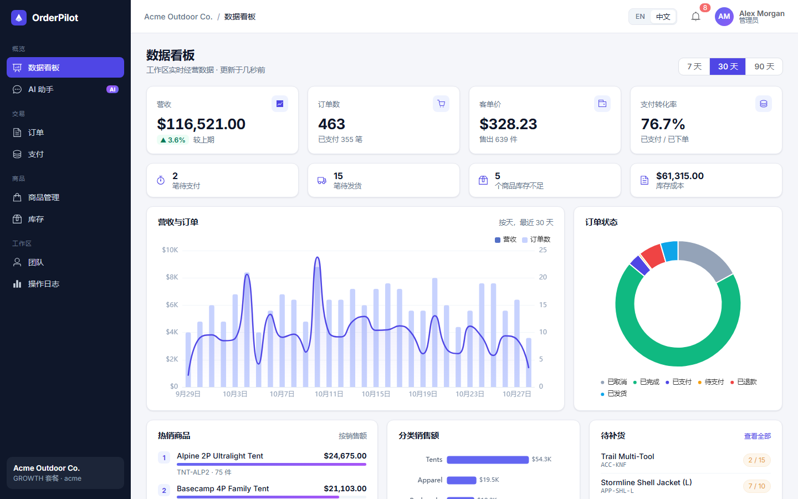
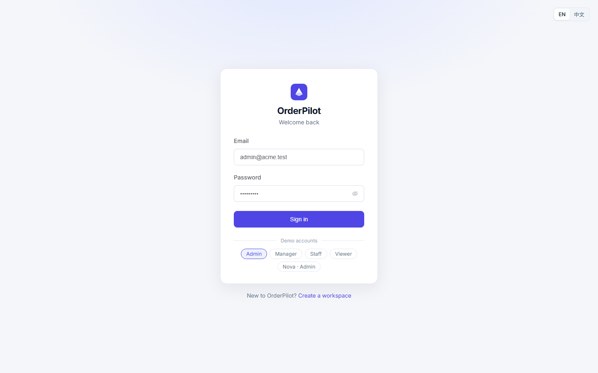
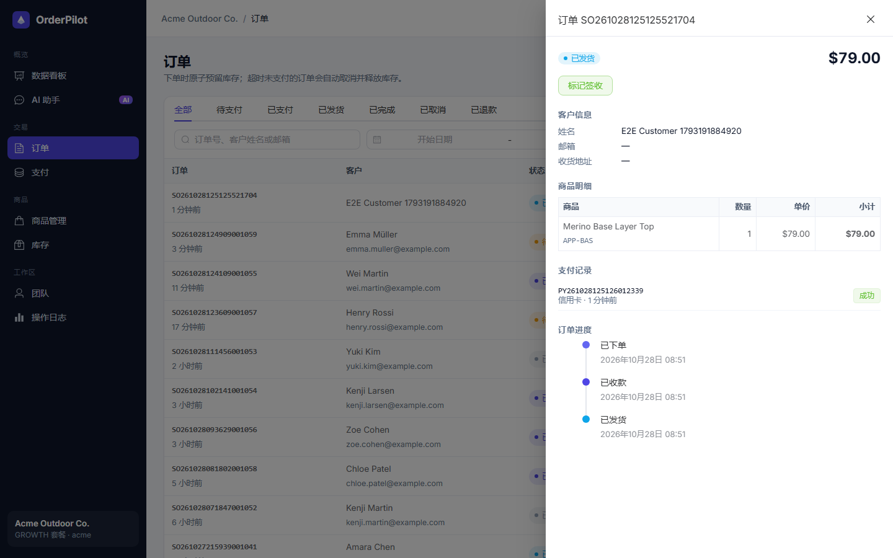
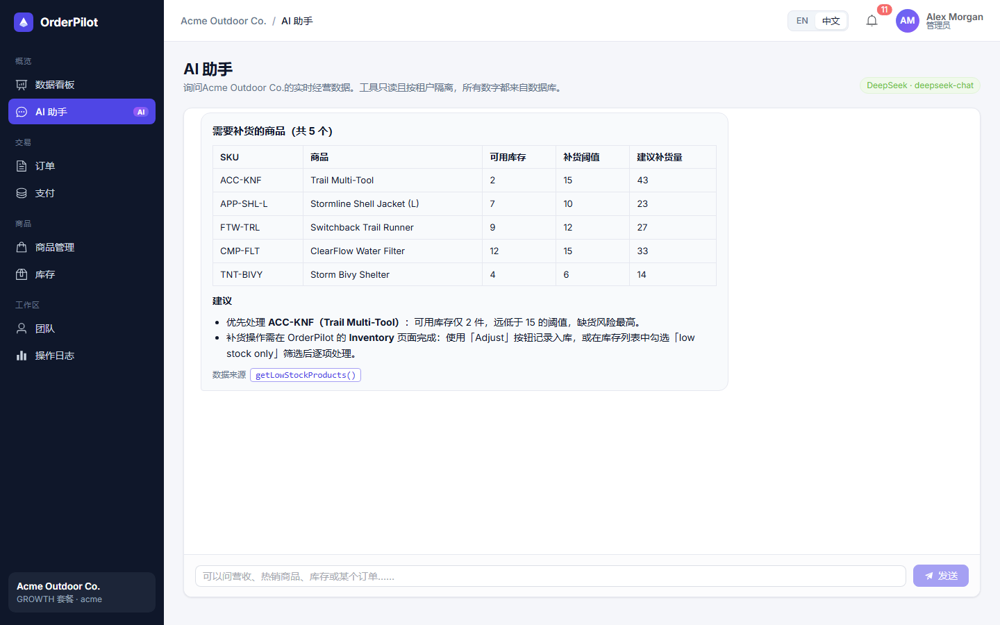

**简体中文** | [English](README.en.md)

# OrderPilot

OrderPilot 是一个多租户的订单与库存管理 SaaS，由 Spring Boot 模块化单体后端、Vue 3 管理后台和一个 AI 经营助手组成。

业务规模不大，但工程上的难点都按生产环境的标准来做：高并发下不超卖、重复提交不会重复下单、MySQL 和 RabbitMQ 之间消息不丢、未付款订单到点自动取消、Redis 缓存，以及从三个层面把关的租户隔离。AI 助手只能通过只读、限定租户的工具查数据，不会编造数字。



## 当前状态

V1 的功能已经齐全，整条链路都能跑通：后端、中英双语前端、AI 助手、演示数据、自动化测试、Docker Compose 部署和 GitHub Actions CI 都已完成，[CI 在 GitHub 上运行通过](https://github.com/JaxLim/OrderPilot/actions)。

还没做或有意简化的部分：

- 支付网关是模拟的；如果进程恰好在支付的两个事务之间崩溃，留下的 `PENDING` 支付目前没有对账任务来处理。
- 通知靠每 10 秒轮询一次，还没换成 SSE；AI 回答不是流式输出，对话记录也不会保存。
- 演示数据里的历史订单是直接写进数据库的，不经过 Outbox，也没有逐单的库存流水。
- 只翻译界面文字，商品名、客户名、审计详情等业务数据不翻译。

完整清单见 [PROJECT_STATUS.md](PROJECT_STATUS.md)（英文）。

## 界面截图

| 登录 | 订单详情 | AI 助手（DeepSeek） |
| --- | --- | --- |
|  |  |  |

## 核心问题与实现

| 问题 | 解法 | 验证 |
| --- | --- | --- |
| 并发超卖 | 用一条条件更新 `UPDATE … WHERE available >= qty` 原子地完成检查和扣减；多个商品按 ID 顺序加锁，避免死锁 | `InventoryConcurrencyIT`：40 个并发买家抢 10 件，恰好 10 单成功 |
| 重复提交与重试 | 请求带 `Idempotency-Key`，Redis `SET NX` 占位并缓存响应，重复请求直接返回原结果；数据库 `UNIQUE(tenant_id, idempotency_key)` 兜底 | `IdempotencyIT`：15 个并发重复请求只生成 1 单 |
| MySQL 与 RabbitMQ 双写 | 事务型 Outbox（`Propagation.MANDATORY`）；中继进程使用发布确认和 mandatory 退回，失败按退避策略重试，并用 `FOR UPDATE SKIP LOCKED` 认领 | `OrderLifecycleIT` |
| 至少一次投递 | 幂等消费者（在同一事务里写去重记录），监听器重试失败后进入死信队列 | 同上，断言不产生重复通知 |
| 未付款订单占着库存 | RabbitMQ TTL + 死信延迟队列到点即取消，定时扫描兜底；两条路径都对状态做 CAS | `OrderLifecycleIT` |
| 支付和超时撞车 | 支付分三步：事务 1 加锁并写入 PENDING → 在事务外调用网关 → 事务 2 做 CAS；钱打进已过期的订单会自动退款 | `PaymentService` |
| 租户数据泄露 | 租户只从签名 JWT 中取；所有 SQL 都按 `tenant_id` 过滤；MyBatis 拦截器会**拒绝**任何没带 `tenant_id` 的租户表语句 | `SecurityAndTenancyIT`、`UnitTests` |
| 热门商品频繁读取 | Redis 旁路缓存：TTL 加随机抖动、空值占位防穿透、事务提交后再删缓存、Redis 故障时自动降级；库存数量不进缓存 | `ProductCache` |
| AI 编造数据 | Spring AI `ChatClient` 配 7 个只读 `@Tool`，租户在服务端绑定；没配密钥时改用结果固定的离线分析模式 | `OrderLifecycleIT`、Playwright |

## 技术栈

- **后端**：Java 21、Spring Boot 3.5、Spring Security（JWT、方法级权限）、MyBatis、MySQL 8.4 + Flyway、Redis 7、RabbitMQ 3、Spring AI 1.1（DeepSeek，OpenAI 兼容接口）、springdoc OpenAPI
- **前端**：Vue 3 + TypeScript、Vite、Element Plus、Pinia、Vue Router、vue-i18n（English / 简体中文）、ECharts
- **测试**：JUnit 5 + Testcontainers（真实的 MySQL / Redis / RabbitMQ）、Playwright 端到端测试
- **部署**：Docker 多阶段构建、Docker Compose、nginx、GitHub Actions

### 架构

后端是一个可独立部署的模块化单体，按业务能力拆分：

```
backend/src/main/java/com/orderpilot/
  common/        统一响应、错误码、TenantContext 与租户拦截器、幂等
  iam/           JWT 登录、角色与权限、用户、租户
  catalog/       商品 + Redis 旁路缓存
  inventory/     原子预占库存、库存流水
  order/         订单状态机、超时取消（消息队列 + 定时扫描）
  payment/       模拟支付网关、三步支付、退款
  messaging/     事务型 Outbox、中继、RabbitMQ 拓扑、消费去重
  notification/  事件消费 → 站内通知
  analytics/     看板读模型（Redis 缓存）
  ai/            Spring AI 助手、工具、离线分析
  audit/         操作日志
  demo/          演示数据生成
frontend/        Vue 3 管理后台 + Playwright 测试
docs/            ARCHITECTURE.md、INTERVIEW_GUIDE.md、截图
```

模块之间直接调用服务方法，副作用则变成领域事件，经 Outbox 发布到 RabbitMQ。详细设计见 [docs/ARCHITECTURE.md](docs/ARCHITECTURE.md)（英文）。

## 快速开始（Docker）

只需安装 [Docker Desktop](https://www.docker.com/products/docker-desktop/)（或 Docker Engine + Compose 插件）。

```bash
git clone https://github.com/JaxLim/OrderPilot.git
cd OrderPilot
docker compose up -d --build --wait
```

第一次构建要在容器里下载 Maven 依赖，可能要十几分钟。所有容器都健康后，打开 **http://localhost:8081**，用下面任一演示账号登录，密码均为 `Passw0rd!`：

| 邮箱 | 角色 | 工作区 |
| --- | --- | --- |
| `admin@acme.test` | 管理员 | Acme Outdoor Co.（约 75 天的订单数据） |
| `manager@acme.test` | 经理 | Acme Outdoor Co. |
| `staff@acme.test` | 员工 | Acme Outdoor Co. |
| `viewer@acme.test` | 只读 | Acme Outdoor Co. |
| `admin@nova.test` | 管理员 | Nova Electronics（另一个租户） |

登录页和界面右上角都有 **EN / 中文** 切换按钮，选择会保存在浏览器里。

其他地址：

- API：http://localhost:8080/api
- Swagger UI：http://localhost:8080/swagger-ui.html
- RabbitMQ 控制台：http://localhost:15672 （guest / guest）

停止：`docker compose down`；连同数据一起删除：`docker compose down -v`。

## 配置 AI 助手（可选）

不配置密钥时，AI 助手以**离线分析模式**运行：用的是同一套工具和真实数据，回答内容固定，支持中英文。要接入 DeepSeek（或任何 OpenAI 兼容接口）：

```bash
cp .env.example .env
# 编辑 .env，填写 AI_API_KEY
docker compose up -d --build
```

| 变量 | 默认值 | 说明 |
| --- | --- | --- |
| `AI_API_KEY` | 空 | API 密钥；为空时使用离线分析模式 |
| `AI_BASE_URL` | `https://api.deepseek.com` | 任意 OpenAI 兼容接口地址 |
| `AI_MODEL` | `deepseek-chat` | 模型名称 |
| `AI_PROVIDER_NAME` | `DeepSeek` | 界面上显示的服务商名称 |
| `JWT_SECRET` | Compose 内置的演示值 | JWT 签名密钥，正式使用时请换成至少 32 位的随机字符串 |

密钥只有后端会读取：浏览器只调用 `/api/ai/chat`，`/api/ai/status` 也只返回模式、服务商和模型名。`.env` 不会进入 Git，也不会被打包进 Docker 镜像；日志里的 `sk-…` 会被打码；测试会强制清空 `AI_API_KEY`，CI 不会调用真实接口。

## 本地开发

需要：JDK 21、Maven 3.9、Node.js 22 或更高版本、Docker（用于运行中间件）。

```bash
# 1. 启动 MySQL（端口 3307）、Redis、RabbitMQ
docker compose up -d mysql redis rabbitmq

# 2. 启动后端：http://localhost:8080 ，首次启动会写入演示数据，并读取 ../.env 中的 AI_* 配置
cd backend
mvn spring-boot:run

# 3. 另开一个终端启动前端：http://localhost:5173 ，/api 请求代理到 8080
cd frontend
npm install
npm run dev
```

## 测试

```bash
# 后端：31 个单元与集成测试；Testcontainers 会启动真实的 MySQL / Redis / RabbitMQ，需要 Docker
cd backend
mvn verify

# 前端：类型检查与生产构建
cd frontend
npm run build

# 端到端：6 个 Playwright 测试，需先启动完整服务
cd frontend
npx playwright install chromium
npm run e2e                                    # 针对 http://localhost:5173
E2E_BASE_URL=http://localhost:8081 npm run e2e # 针对 Docker 部署
```

GitHub Actions（`.github/workflows/ci.yml`）在推送到 `main` 和每个 PR 时运行三个任务：后端 `mvn verify`、前端构建，以及基于 Docker Compose 的 Playwright 端到端测试。

## 更多文档

- [docs/ARCHITECTURE.md](docs/ARCHITECTURE.md)：架构与关键设计（英文）
- [docs/INTERVIEW_GUIDE.md](docs/INTERVIEW_GUIDE.md)：项目讲解与常见深挖问题（英文）
- [PROJECT_STATUS.md](PROJECT_STATUS.md)：已完成功能、测试记录、已知问题与后续计划（英文）
