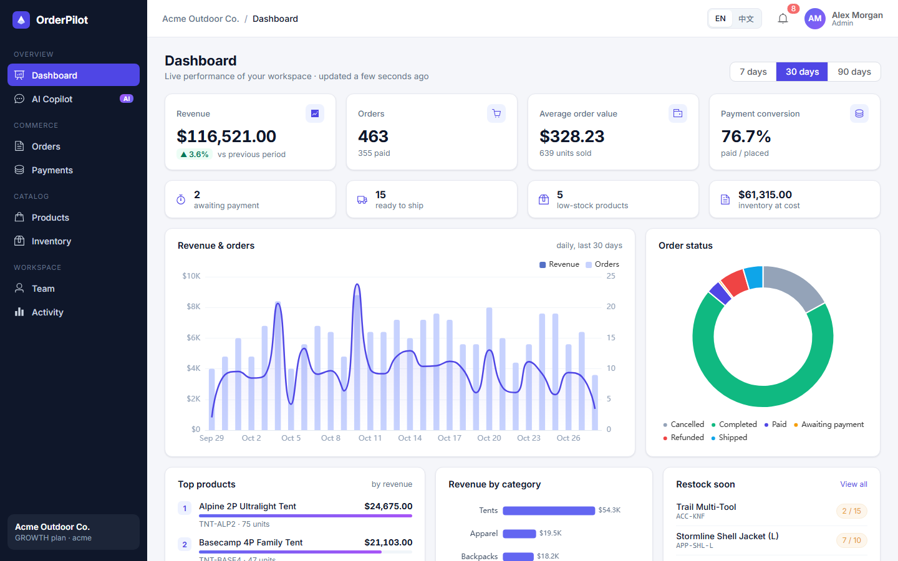
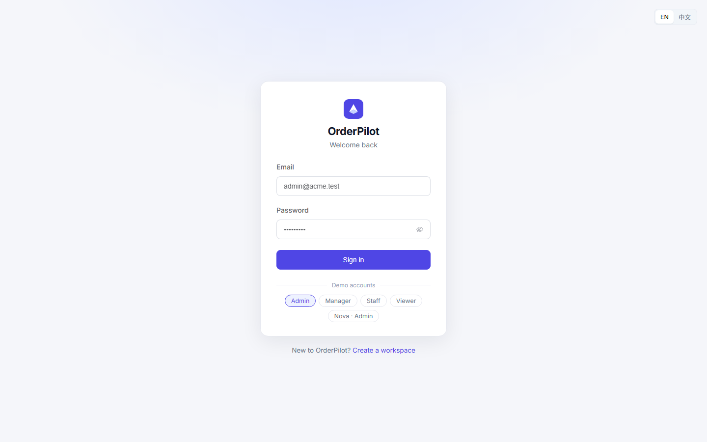
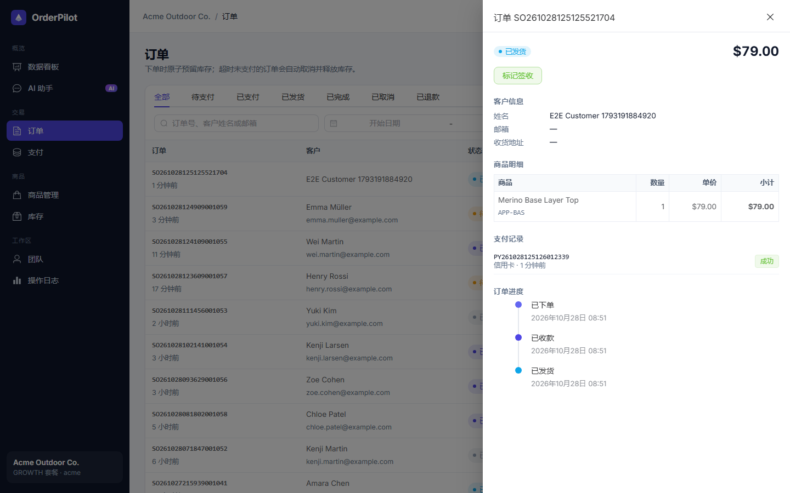
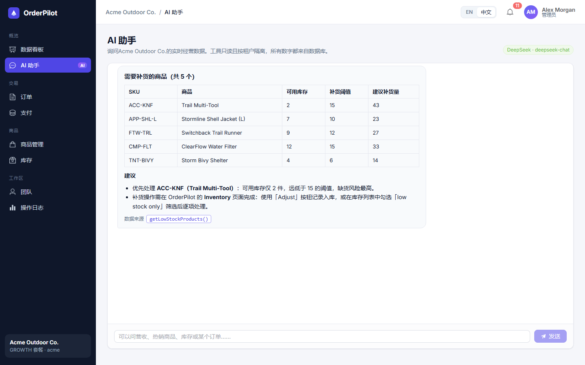
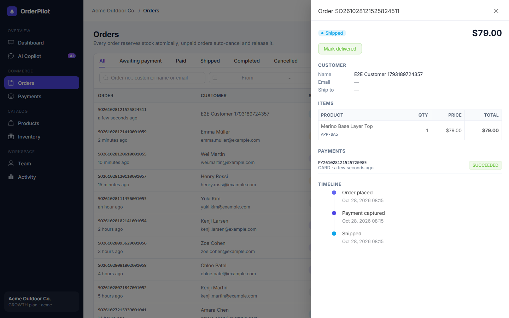
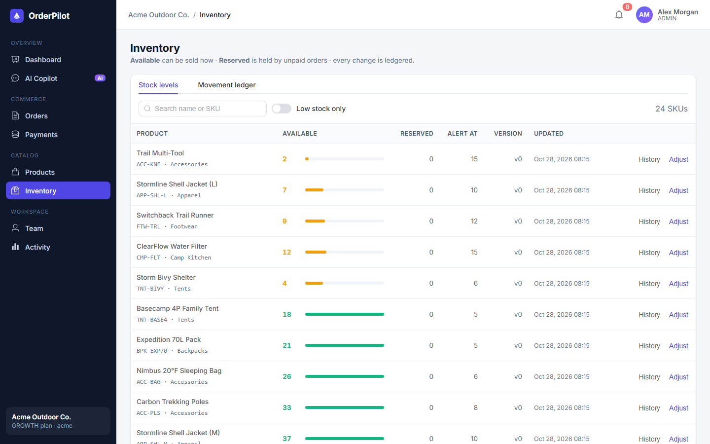
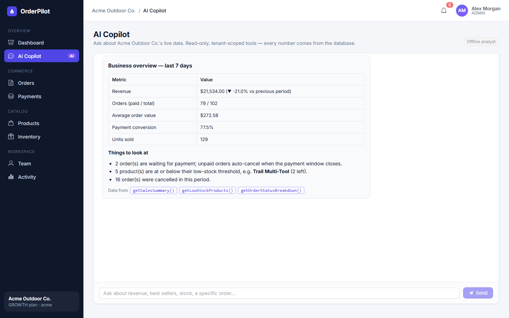

# OrderPilot

**Multi-tenant order & inventory SaaS** — a modular-monolith Spring Boot backend, a Vue 3 dashboard and an AI business copilot.
The product is small but the hard parts are real: oversell-proof stock under concurrency, idempotent APIs, a transactional outbox
with reliable RabbitMQ delivery, delayed order cancellation, Redis caching, and tenant isolation enforced at three layers.



## Highlights

| Problem | How OrderPilot solves it | Proof |
|---|---|---|
| Overselling under concurrency | Single conditional `UPDATE … WHERE available >= qty` (atomic check-and-decrement), lines locked in product-id order to avoid deadlocks | `InventoryConcurrencyIT` — 40 concurrent buyers, 10 units → exactly 10 orders |
| Duplicate submits / retries | `Idempotency-Key` header → Redis `SET NX` claim + replayable response; `UNIQUE(tenant_id, idempotency_key)` as last line of defence | `IdempotencyIT` — 15 concurrent duplicates → 1 order |
| MySQL ↔ RabbitMQ dual-write | Transactional outbox (`Propagation.MANDATORY`), relay with publisher confirms + mandatory returns, retries with back-off, `FOR UPDATE SKIP LOCKED` | `OrderLifecycleIT.domainEventsFlowThroughOutboxToNotifications` |
| At-least-once delivery | Idempotent consumers (`consumed_message` de-dup row in the same TX), listener retry → DLQ | same test asserts no duplicate notifications |
| Unpaid orders holding stock | RabbitMQ TTL + dead-letter delay queue cancels exactly at expiry; scheduled sweeper as safety net; both use a CAS on status | `OrderLifecycleIT.unpaidOrderIsCancelledByTheRabbitMqDelayQueue` |
| Pay vs. timeout race | Payment in 3 steps (TX1 lock + PENDING row → gateway call outside TX → TX2 CAS); money captured for an expired order is auto-refunded | `PaymentService` |
| Tenant data leaks | Tenant from signed JWT only → `TenantContext`; every SQL filters `tenant_id`; a MyBatis interceptor **rejects** any statement on a tenant table without `tenant_id` | `SecurityAndTenancyIT`, `UnitTests.TenantGuard` |
| Hot catalog reads | Redis cache-aside with TTL jitter, null-sentinel (penetration), delete-after-commit invalidation, graceful degradation; stock is never cached | `ProductCache` |
| AI that doesn't hallucinate numbers | Spring AI `ChatClient` with read-only, server-side tenant-bound `@Tool`s; deterministic offline analyst when no key is configured | `OrderLifecycleIT.dashboardAndAssistantReflectRealData`, Playwright |

<table><tr>
<td></td>
<td></td>
<td></td>
</tr><tr>
<td></td>
<td></td>
<td></td>
</tr></table>

## Tech stack

- **Backend:** Java 21, Spring Boot 3.5, Spring Security (JWT, method security), MyBatis, MySQL 8.4 + Flyway, Redis 7, RabbitMQ 3, Spring AI 1.1 + DeepSeek (OpenAI-compatible), springdoc OpenAPI
- **Frontend:** Vue 3 + TypeScript, Vite, Element Plus, Pinia, Vue Router, vue-i18n (English / 简体中文), ECharts
- **Testing:** JUnit 5 + Testcontainers (real MySQL/Redis/RabbitMQ), Playwright E2E
- **DevOps:** Docker multi-stage builds, Docker Compose, nginx, GitHub Actions

## Quick start (Docker — everything)

```bash
docker compose up -d --build --wait
```

Open **http://localhost:8081** and sign in with a demo account (password `Passw0rd!`):

| Email | Role | Workspace |
|---|---|---|
| `admin@acme.test` | Admin | Acme Outdoor Co. (24 products, ~75 days of orders) |
| `manager@acme.test` | Manager | Acme Outdoor Co. |
| `staff@acme.test` | Staff | Acme Outdoor Co. |
| `viewer@acme.test` | Viewer (read-only) | Acme Outdoor Co. |
| `admin@nova.test` | Admin | Nova Electronics (separate tenant) |

Other endpoints: API `http://localhost:8080/api`, Swagger UI `http://localhost:8080/swagger-ui.html`,
RabbitMQ console `http://localhost:15672` (guest/guest).

The UI is available in **English and 简体中文**. Switch with the EN / 中文 toggle (login page and top bar); the choice is
remembered per browser.

### AI copilot (DeepSeek)

The copilot uses DeepSeek through Spring AI's OpenAI-compatible client. Configure it with environment variables — never in
source or config files:

```bash
cp .env.example .env          # .env is git-ignored
# edit .env and set AI_API_KEY=<your DeepSeek key>
docker compose up -d --build  # Compose reads .env and passes the key to the backend container only
```

| Variable | Default | Purpose |
|---|---|---|
| `AI_API_KEY` | *(empty)* | DeepSeek API key. Empty → offline analyst mode |
| `AI_BASE_URL` | `https://api.deepseek.com` | Any OpenAI-compatible endpoint |
| `AI_MODEL` | `deepseek-chat` | Model name |
| `AI_PROVIDER_NAME` | `DeepSeek` | Label shown in the UI |

How the key is protected:

- Only the backend reads it. The browser calls `/api/ai/chat`, and `/api/ai/status` returns just the mode, provider and model.
- It's never committed: `.env` / `.env.*` are git-ignored (only `.env.example` with placeholders is tracked) and excluded from
  Docker build contexts.
- It's never logged: the startup log prints the provider and model only, and provider errors are logged through a redactor
  that masks `sk-…` tokens (unit-tested).
- Tests force `AI_API_KEY=` so CI and `mvn test` never call the real API.

Without a key the copilot runs in **offline analyst** mode: same tools, same real data, deterministic answers in English or
Chinese.

## Local development

Prerequisites: JDK 21, Maven 3.9, Node 22+, Docker.

```bash
docker compose up -d mysql redis rabbitmq        # infra (MySQL on :3307)
cd backend && mvn spring-boot:run                # API on :8080, seeds demo data; reads AI_* from ../.env
cd frontend && npm install && npm run dev        # UI on :5173 (proxies /api to :8080)
```

## Tests

```bash
cd backend && mvn verify                         # 31 tests: unit + Testcontainers integration (needs Docker)
cd frontend && npx playwright install chromium && npm run e2e   # 6 E2E tests against a running stack
E2E_BASE_URL=http://localhost:8081 npm run e2e   # ...or against the Docker stack
```

## Project layout

```
backend/   Spring Boot modular monolith
  common/      api envelope, errors, TenantContext + TenantGuardInterceptor, idempotency
  iam/         JWT auth, roles → permissions, users, tenants
  catalog/     products + Redis cache-aside
  inventory/   atomic stock reservation, movement ledger
  order/       order state machine, timeout handlers (MQ + sweeper)
  payment/     simulated gateway, 3-step payment, refunds
  messaging/   transactional outbox, relay, RabbitMQ topology, consumer de-dup
  notification/ event consumer → in-app notifications
  analytics/   dashboard read models (Redis-cached)
  ai/          Spring AI copilot, tools, offline analyst
  audit/       activity trail
  demo/        realistic demo data seeder
frontend/  Vue 3 SaaS dashboard + Playwright tests
docs/      ARCHITECTURE.md, INTERVIEW_GUIDE.md, screenshots
```

More: [docs/ARCHITECTURE.md](docs/ARCHITECTURE.md) · [docs/INTERVIEW_GUIDE.md](docs/INTERVIEW_GUIDE.md) · [PROJECT_STATUS.md](PROJECT_STATUS.md)
