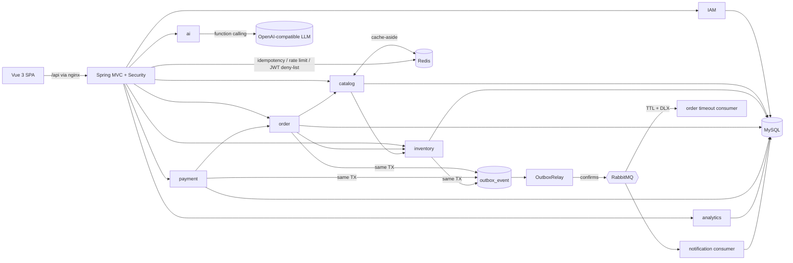

# OrderPilot architecture

## 1. Shape: a modular monolith

One deployable Spring Boot application, split into modules by business capability (`iam`, `catalog`, `inventory`, `order`,
`payment`, `messaging`, `notification`, `analytics`, `ai`, `audit`). Modules talk through **public service methods**, never
through each other's mappers. Cross-module side effects travel as **domain events** through the outbox.

Why not microservices? One team, one database, strong consistency needs (stock + order must commit together). A monolith gives
local ACID transactions for free; the module boundaries + event-driven integration keep the option to extract a service later
(e.g. `notification` already only consumes events).



## 2. Multi-tenancy (shared schema)

Every business table has `tenant_id`; tenant-scoped unique keys are composite (`UNIQUE(tenant_id, sku)`).

Isolation is enforced in three independent layers:

1. **Identity** — the tenant id comes only from the signed JWT (`JwtAuthenticationFilter` → `TenantContext`, a ThreadLocal
   cleared in `finally`). There is no `X-Tenant-Id` header to tamper with.
2. **Query** — every mapper method takes `tenantId` explicitly and filters on it. Reads of another tenant's id return **404**,
   not 403, so existence is not leaked.
3. **Guard rail** — `TenantGuardInterceptor` (MyBatis plugin) inspects every statement; SQL touching a tenant table without a
   `tenant_id` predicate throws. Intentionally cross-tenant statements (login by email, outbox relay, expiry sweeper) must be
   named `*Global`, which makes them stand out in code review.

Async work (MQ consumers, schedulers) binds the tenant from the event envelope with `TenantContext.callAs(...)`.
The AI tools receive the tenant id in their constructor on the server; the model can never choose it.

## 3. Inventory: concurrency-safe stock

`inventory(available, reserved, version)` with `CHECK (available >= 0)`.

| Operation | SQL (all single statements) |
|---|---|
| reserve (order placed) | `available -= q, reserved += q WHERE available >= q` |
| release (cancel/timeout) | `available += q, reserved -= q WHERE reserved >= q` |
| commit (paid) | `reserved -= q WHERE reserved >= q` |
| restock / adjust | `available += d WHERE available + d >= 0` |

InnoDB row-locks the row for the UPDATE and evaluates the `WHERE` against the latest committed version, so check-and-decrement
is atomic. `rows affected = 0` ⇒ insufficient stock ⇒ exception ⇒ the whole order transaction rolls back (earlier lines too).
Multi-line orders sort lines by product id so concurrent orders acquire row locks in the same order — no deadlock cycles
(proven by `multiLineOrdersInOppositeOrderDoNotDeadlock`). Every change is appended to `inventory_movement` (ledger).

Alternatives considered: `SELECT … FOR UPDATE` then update (two round trips, same lock), optimistic `version` retry loops
(retry storms on hot SKUs), Redis Lua pre-deduction (needed only for flash-sale scale; adds a reconciliation problem).

## 4. Order lifecycle and payments

```
PENDING_PAYMENT ──pay──▶ PAID ──ship──▶ SHIPPED ──complete──▶ COMPLETED
      └── cancel / timeout ──▶ CANCELLED      PAID ──refund──▶ REFUNDED
```

Transitions are checked in Java (`OrderStatus.canTransitionTo`, readable errors) **and** in SQL
(`UPDATE … WHERE status = 'PENDING_PAYMENT'`), which makes "pay" and "timeout" racing on the same order safe: exactly one wins.

Payment flow (`PaymentService`):

1. **TX1** `SELECT … FOR UPDATE` the order, verify payable and not expired, reject if another payment is in flight, insert
   `payment(PENDING)`.
2. **Gateway call outside any transaction** (no DB locks held during network latency).
3. **TX2** CAS payment → `SUCCEEDED`, CAS order → `PAID`, commit reserved stock, emit `order.paid`. If the order CAS fails
   (it timed out meanwhile), the charge is refunded automatically — money is never silently kept.

Declined payments null their idempotency key, so the client can retry with the same key.

## 5. Idempotency

`IdempotencyService.execute(scope, key, type, action)`:
`SET op:idem:{tenant}:{scope}:{key} __PROCESSING__ NX EX 24h` → run → store serialized response (replay) or delete on failure.
Concurrent duplicate → `409 REQUEST_IN_PROGRESS`. If Redis is down the system still works: the DB unique key on
`(tenant_id, idempotency_key)` rejects the duplicate, and the service resolves it to the existing order.

## 6. Reliable messaging

- **Outbox**: `OutboxService.publish` is `@Transactional(propagation = MANDATORY)` — it *cannot* be called outside the business
  transaction. Event and state change commit atomically.
- **Relay**: every 500 ms, `SELECT … FOR UPDATE SKIP LOCKED LIMIT 50` (multi-instance safe), publish with correlated
  **publisher confirms** and `mandatory=true` returns. Marked `SENT` only on ack *and* routed; otherwise exponential back-off,
  `FAILED` after 10 attempts (visible in *Activity → Event pipeline*).
- **Consumers**: at-least-once ⇒ idempotent. `ConsumerDeduplicator` inserts `(message_id, consumer)` with `INSERT IGNORE`
  in the consumer's transaction. Spring retry (3 attempts, exponential) then reject → dead-letter queue.
- **Delayed cancellation**: `order.created` is also routed to `op.order.delay` (TTL = payment timeout, no consumer). Expired
  messages dead-letter to `op.order.timeout`, whose consumer runs the idempotent `expireIfUnpaid`. A one-minute sweeper covers
  broker outages.

Topology:

```
orderpilot.events (topic) ─ order.*|payment.*|inventory.* ─▶ op.notification ──DLX──▶ op.notification.dlq
                          └ order.created ─▶ op.order.delay (TTL) ──DLX "order.timeout"──▶ op.order.timeout
```

## 7. Caching (Redis)

| Key | Purpose | Policy |
|---|---|---|
| `op:t:{tid}:product:{id}` | catalog entry for the order path | cache-aside, 30 min + 0–5 min jitter, null sentinel 2 min, delete after commit |
| `op:t:{tid}:dashboard:{days}` | aggregated KPIs | 30 s TTL (read-heavy, eventual is fine) |
| `op:idem:*` | idempotency | 24 h |
| `op:jwt:deny:{jti}` | logout | TTL = token remaining life |
| `op:ratelimit:login:{email}`, `op:ratelimit:ai:{user}` | throttling | fixed window |

Stock is deliberately **not** cached: it changes on every order and must be exact. All Redis paths degrade gracefully
(log + fall back to DB) because Redis is an optimisation, not the source of truth.

## 8. Security

- Stateless JWT (HS384), 8 h, `jti` deny-list on logout; BCrypt passwords; constant-work login (dummy hash for unknown emails)
  and identical error messages to prevent user enumeration; login rate limit.
- RBAC: roles map to permissions (`order:write`, `payment:refund`, …); endpoints use `@PreAuthorize("hasAuthority(...)")`,
  never role names. The UI hides what you cannot do, but the server is the authority.
- A workspace cannot remove its last active admin.

## 9. AI copilot

`AssistantService` builds a Spring AI `ChatClient` call with a system prompt (tenant name, date, rules: tools for every number,
read-only, stay on topic) plus conversation history, and registers a per-request `BusinessTools` instance whose `@Tool`
methods are read-only queries bound to the caller's tenant. The response reports which tools were invoked (shown in the UI as
provenance). Per-user rate limiting protects cost. If no API key is set or the provider fails, `OfflineAnalyst` routes the
question by intent to the same tools and renders Markdown — so the feature always demos and never invents data.

Provider: DeepSeek (`deepseek-chat`) via Spring AI's OpenAI client (`AI_BASE_URL=https://api.deepseek.com`); any
OpenAI-compatible API works by changing `AI_BASE_URL` / `AI_MODEL`.

Secret handling: `AI_API_KEY` comes only from the environment (Docker Compose reads the git-ignored `.env`; local
`mvn spring-boot:run` imports `../.env` via `spring.config.import`). `AiKeyEnvironmentPostProcessor` decides at startup
whether LLM mode is on and substitutes a placeholder for a blank key (Spring AI refuses to start with an empty one). The key
never reaches the frontend (`/api/ai/status` exposes mode/provider/model only) and provider errors are logged through a
redactor that masks `sk-…` tokens.

The chat request carries the UI language (`lang: en|zh`); the system prompt tells the model to answer in Simplified Chinese
when `zh`, and the offline analyst has full Chinese templates and recognises Chinese questions (补货, 热销, 营收, …).

## 11. Internationalisation (English / 简体中文)

- Frontend: `vue-i18n` (composition API) with `src/i18n/en.ts` and `zh.ts` (`zh` is typed as `typeof en`, so a missing key
  fails the type-check). The language toggle updates vue-i18n, Element Plus's locale (`el-config-provider`), dayjs (relative
  times, weekday names) and the document title; the choice is stored in `localStorage` and defaults to the browser language.
- API errors: the server returns a stable `code` plus an English message. In Chinese the UI shows the translated reason for
  the code and keeps the server's specifics (SKU, quantities) as detail.
- Notifications store their event payload in `notification.params` (migration V2), so the bell renders them in the viewer's
  language instead of the English text written at consume time.
- Business data (product names, customer names) is shown as entered. Currency stays USD in both languages.

## 10. Data model

`tenant`, `app_user`, `product`, `inventory`, `inventory_movement`, `sales_order`, `order_item`, `payment`, `outbox_event`,
`consumed_message`, `notification`, `audit_log` — see `backend/src/main/resources/db/migration/V1__init_schema.sql`.
All timestamps are UTC (`DATETIME(3)`); the UI converts to the viewer's zone.
